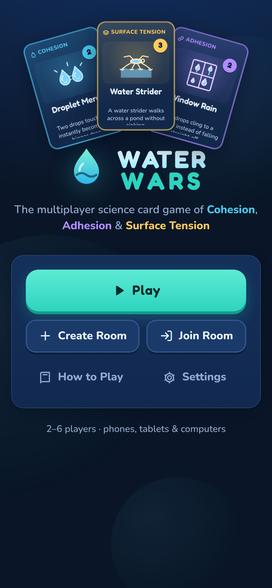
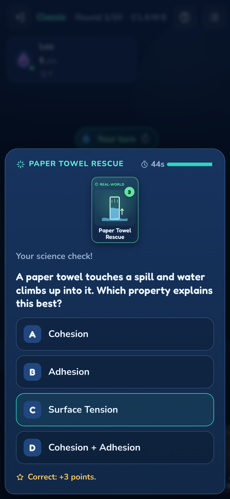
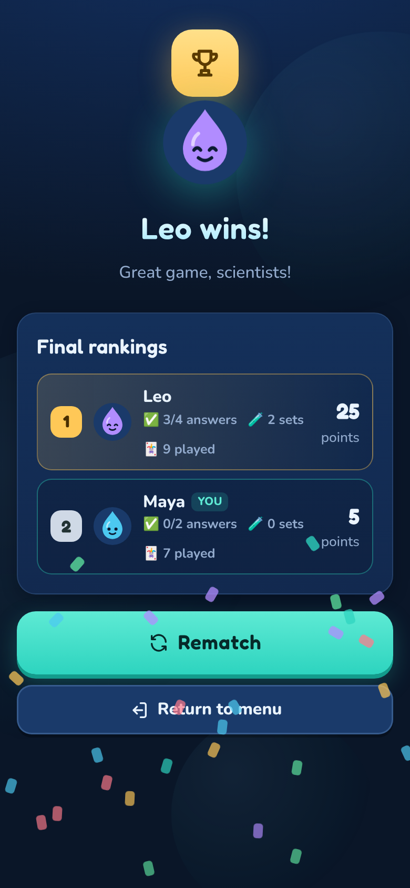

# 💧 Water Wars

A real-time multiplayer science card game about the three properties of water: **cohesion**, **adhesion** and **surface tension**. 2 to 6 players join a room with a 5-character code from any phone, tablet or computer, then play **Classic** (UNO-style) or **Battle** (drop vs. drop) mode. Science questions are part of the moves themselves: challenging an opponent, classifying a real-world example and boosting an attack all depend on answering correctly.

<p align="center">
  
  
  
</p>

---

## Contents
1. [Deploying (about 10 minutes)](#deploying-about-10-minutes)
2. [Environment variables](#environment-variables)
3. [How to play](#how-to-play)
4. [Architecture](#architecture)
5. [Local development & tests](#local-development--tests)
6. [Free-tier notes](#free-tier-notes)
7. [Troubleshooting](#troubleshooting)

---

## Deploying (about 10 minutes)

Netlify hosts the website and the game server (a Netlify Function). **Supabase** (free plan) stores the games and pushes live updates to every device. Netlify can't keep live connections open itself, so you need both. No credit card is required for either.

### Step 1: Create the Supabase backend

1. Go to <https://supabase.com> and sign in (signing in with GitHub works). Click **New project**: pick any name, set a database password (save it somewhere; the game doesn't need it), choose the region closest to your players, then **Create new project**. It takes a minute or two to start.
2. **Create the tables:** open **SQL Editor** (left sidebar) → **New query**, paste the entire contents of [`supabase/schema.sql`](supabase/schema.sql), and click **Run**. You should see *"Success. No rows returned."*
   This creates two tables and locks them so that only the game server can read or write them.
3. **Copy three values** from the dashboard (the **Connect** button at the top, or **Project Settings → API Keys** and **Project Settings → Data API**):
   * **Project URL**, e.g. `https://abcdefghijkl.supabase.co`
   * **Publishable key** (starts with `sb_publishable_`). This one is public and safe to expose.
   * **Secret key** (starts with `sb_secret_`; click to reveal). **Keep it secret.** Only Netlify should have it.

   Older projects show `anon` and `service_role` keys instead; those work too (anon = publishable, service_role = secret).
4. **Realtime check:** in **Project Settings → Realtime**, make sure public channels are allowed (i.e. *"Allow public access"* is on / *"private channels only"* is off). That's the default for new projects.
   The channels carry only "something changed" signals with unguessable names; the actual game data is always fetched through the server.

### Step 2: Deploy to Netlify

1. In Netlify: **Add new site → Import an existing project →** pick this GitHub repository.
   The build settings are read from [`netlify.toml`](netlify.toml) (build `npm run build`, publish `dist`, functions `netlify/functions`), so leave them alone.
2. Open **Site configuration → Environment variables** and add:

   | Key | Value |
   |---|---|
   | `SUPABASE_URL` | Project URL from step 1.3 |
   | `SUPABASE_PUBLISHABLE_KEY` | Publishable key (`sb_publishable_…`) |
   | `SUPABASE_SECRET_KEY` | Secret key (`sb_secret_…`) |

3. **Deploys → Trigger deploy → Deploy site.** Environment variable changes only take effect after a redeploy.
4. Open your site URL (e.g. `https://water-wars-xyz.netlify.app`) and share it. Players tap **Play → Create Room**, then share the room code or the **Invite link**.

If something is missing, the site shows a **"Almost ready to play!"** screen listing the variables that still need to be set. If the tables weren't created, starting a room shows a message saying to run `supabase/schema.sql`.

---

## Environment variables

All configuration lives in Netlify's environment variables. The browser fetches its public settings from `/api/config` at runtime, so there are **no build-time variables** and the secret key is never sent to the browser.

| Variable | Required | Secret | Purpose |
|---|---|---|---|
| `SUPABASE_URL` | ✅ | no | Your project URL. |
| `SUPABASE_PUBLISHABLE_KEY` | ✅ | no | Public key the browser uses to listen for live updates. (`SUPABASE_ANON_KEY` also accepted.) |
| `SUPABASE_SECRET_KEY` | ✅ | 🔒 yes | Lets the game server read and write games. (`SUPABASE_SERVICE_ROLE_KEY` also accepted.) |
| `WW_SESSION_SECRET` | optional | 🔒 | Signs player tokens. If unset, a value derived from the secret key is used. |

---

## How to play

Every card is linked to cohesion, adhesion or surface tension. There are **42 unique cards** (67 in the deck) in seven categories: Cohesion, Adhesion, Surface Tension, Challenge, Action, Real-World and Power-Up. The bank holds **40 science questions** plus 6 real-world classification cards, including combination questions such as *"Water rises in a narrow tube. Explain cohesion AND adhesion."* The full rules and a browsable card library with explanations are in the app under **How to Play**.

### Classic mode (UNO-style): first to empty their hand wins
* Everyone starts with 5 cards. The color under the middle pile is the **active property** (blue = Cohesion, purple = Adhesion, gold = Surface Tension).
* On your turn, play **one card that matches the color**. Playable cards glow. An Action card can always go on another Action card. Real-World and Power-Up cards are **wild**.
* Nothing matches? **Draw a card**, then play it if it matches or end your turn.
* **Action cards:** Soap Disruptor skips the next player, Evaporation reverses the order, Capillary Pull makes the next player draw 2, Surfactant Splash makes everyone else draw 1, and more.
* **Science:** Challenge cards quiz an opponent (wrong answer = they draw 2). Real-World cards ask you to name the property an example shows (wrong = you draw 1). Science Star gives a bonus question (right = take another turn).
* **Win** by playing your last card. If nobody has after 20 rounds, the fewest cards wins.

### Battle mode, with the last drop standing winning
* Every player is a drop with **20 HP**; draw 1 at the start of each turn.
* One **Power-Up** per turn is free (shields, heals, H-Bond Boost for double damage).
* Then play one card: **attack** with a property card, risk a **Science Boost** (correct = double damage, wrong = fizzle), or launch a **Combo** of two different properties with a combination question. Challenges, real-world cards and actions (Soap Disruptor pops shields, Surfactant Splash hits everyone) add variety. Or **Rest** to draw 1 and heal 1.
* After round 10 a **drought** drains 1 HP per turn, so games always finish.

Turns have a 90-second timer (45 s for questions, 30 s for trades). A disconnected player's turn is skipped automatically after 20 seconds, so nobody can stall the game.

---

## Architecture

```
Browser (React + TS, Vite)                 Netlify Function  /api/*                   Supabase
──────────────────────────                 ─────────────────────────                 ───────────────────────────
• POST /api {op:"session"} ──────────────▶ issue random player id + HMAC-signed token
• POST /api {op, action} + token ────────▶ verify token, run game engine,
                                           save with optimistic concurrency ───────▶ Postgres: ww_rooms (RLS locked)
                                           broadcast "room changed" ───────────────▶ Realtime channel (secret name)
• realtime listener ◀─────────────────────────────────────────────────────────────── "changed" ping (no game data)
• GET /api/state?code=… + token ─────────▶ return public view + MY hand only
• Presence (who's online) ◀──────────────────────────────────────────────────────▶ Realtime Presence
```

* **Server-authoritative:** clients only send *intents* ("play card X on player Y"). The function validates turn order, card ownership, matching rules and targets, resolves outcomes, and saves the new state only if nobody else changed it first (`update … where version = expected`, retried on conflict). Simultaneous requests are therefore applied one at a time.
* **Hidden information stays hidden:** the full game (deck order, all hands, answers in play) lives in `ww_rooms`, which has row-level security on and no policies, so the public browser key can't read or change it. Each player's API response contains the public view plus *their own* hand only. The question bank and answers live in `server/answers.ts` and are never shipped to the browser.
* **Spoof-proof updates:** the public key can technically send Realtime messages, so broadcasts never carry game data. They're just "version N is ready" pings, and each device fetches its real state from the server. A forged ping can only cause a harmless extra refresh.
* **Identity without sign-up:** the server gives each browser a random player id with an HMAC signature. Reloading or losing signal drops you back into your seat with your hand intact.
* **Resilience:** devices re-sync every 10 seconds and whenever the tab comes back into view, which heals missed pings and also tells the server who's still connected (disconnected players' turns are skipped automatically). Rooms older than 8 hours are deleted when new rooms are created.

```
src/shared/      card database + types shared by client and server
src/client/      session/config, API client, realtime room hook, settings, sound
src/components/  card component, 39 original SVG card illustrations, UI primitives
src/screens/     Menu, Lobby, Game, Results, How to Play, Settings
server/          engine.ts (rules), answers.ts (answer key), handler.ts (API), store.ts (Supabase), session.ts, views.ts
netlify/functions/api.mts   the deployed function (thin wrapper around server/handler.ts)
supabase/schema.sql         database setup script (also used as the local migration)
tests/           engine unit + fuzz tests, security integration tests
```

---

## Local development & tests

Requirements: Node 20+ and Docker (for a local Supabase).

```bash
npm install
npm run supabase:start   # local Supabase in Docker; applies supabase/migrations automatically
npm run dev              # local API (same handler as the Netlify function) + Vite
# open http://localhost:5173 in two different browsers (or one normal + one private window)
```

The dev API reads the local Supabase keys automatically (via `npx supabase status`), or you can set `SUPABASE_URL`, `SUPABASE_PUBLISHABLE_KEY` and `SUPABASE_SECRET_KEY` yourself to point it at a hosted project.

| Command | What it does |
|---|---|
| `npm test` | Engine tests: card database checks, rules enforcement, hidden-info checks, plus **600 fuzzed full games** (both modes, 2–6 players) asserting card conservation, termination and that rejected moves never change state |
| `npm run test:security` | With `npm run dev` running: **41 integration checks** against the live API + database (forged/impersonated tokens, the public key can't read or modify tables, other hands never sent, turn enforcement, 6 simultaneous duplicate moves apply once, 8 simultaneous joins fill exactly 6 seats, host handover, room deletion) |
| `npm run build` | Typecheck + production build into `dist/` |

### What was tested
All of the following ran against a real Supabase stack (Postgres + PostgREST + Realtime) in Docker:
* Live updates: moves appear on the other device in **~100 ms**, joins in under half a second, and online/offline status changes immediately.
* Two (and four) separate browser contexts creating, joining, readying and starting rooms; **full Classic and Battle games** played to the results screen by clicking through the real UI (6 games), with a consistency check after every move that both clients show the same deck count, discard pile and hand sizes (0 mismatches, 0 rejected moves).
* The same full games and all 41 security checks against the **production build** and the function **as bundled by Netlify CLI** (`netlify functions:serve`).
* Reload mid-game (hand restored), a player disappearing mid-turn (shown offline, turn auto-skipped after ~25 s) and rejoining.
* Phone (360×640, iPhone 13), tablet (768×1024) and laptop layouts, with no horizontal overflow.

**Not tested from here:** a hosted Supabase project and a live Netlify deploy, since no accounts were available in the build environment. Hosted Supabase runs the same software as the local stack used for testing.

---

## Free-tier notes
* **Supabase free:** 500 MB database (a game is a few kilobytes), 200 simultaneous Realtime connections (one per open game tab), 2 million Realtime messages/month (one per move). Free projects **pause after 7 days without activity**; restore with one click in the dashboard (data is kept).
* **Netlify free:** the function runs once per page load, once per move per player (each device fetches its view after a move), and once every 10 s per open game tab as a heartbeat. A class of 30 playing for 45 minutes is roughly 10–15k function calls.
* To shut it down afterwards, delete the Netlify site and the Supabase project.

## Troubleshooting
| Symptom | Fix |
|---|---|
| "Almost ready to play!" screen | Add the listed environment variables in Netlify and **redeploy**. |
| "The database tables are missing" | Run [`supabase/schema.sql`](supabase/schema.sql) in the Supabase SQL Editor. |
| Moves only show up every ~10 seconds | Realtime public channels are disabled: see step 1.4. The game still works, just less instantly. |
| `SERVER` / `DB` errors | Check *Netlify → Logs → Functions → api*. Usually a wrong `SUPABASE_URL` or a key from a different project. The project may also be paused: restore it in Supabase. |
| Two tabs act as the same player | Expected: identity is per browser. Use a private window or another device for a second player. |
